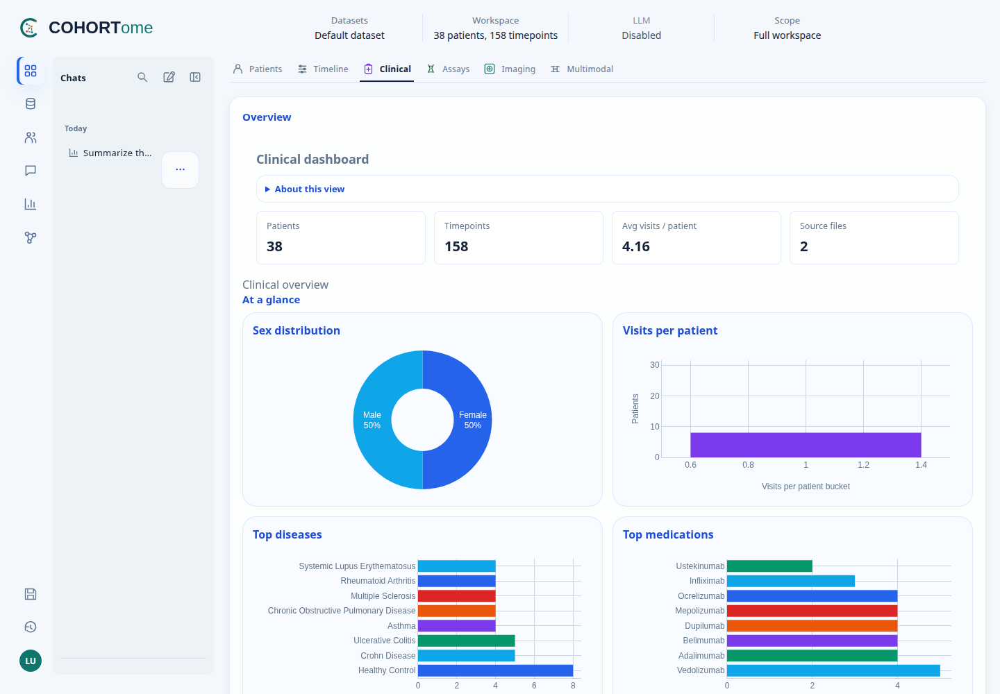

  

<h1 align="center">COHORTome</h1>

  <a href="https://mrueda.github.io/cohortome/">📚 Documentation</a> ·
  <a href="https://mrueda.github.io/cohortome/docs/getting-started/desktop">📦 Installation</a> ·
  <a href="https://mrueda.github.io/cohortome/docs/user-guide/user-journeys">🧭 User guide</a>

COHORTome is an open-source application for clinical and multimodal cohort
analysis. Explore patient records and assays, save cohorts, run analyses, and
inspect their plots and output files. Language models can help interpret
questions and explain results, but are optional.

## Get started

**Desktop is recommended for individual use.**
Follow the [installation guide](https://mrueda.github.io/cohortome/docs/getting-started/desktop)
for release availability and source setup. Packaged installers are forthcoming.

**Web is recommended only for centralized, multi-user systems with dataset
permissions.** See the
[Web deployment guide](https://mrueda.github.io/cohortome/docs/admin-guide/starting-and-stopping).

Start with the bundled synthetic datasets and
[user journeys](https://mrueda.github.io/cohortome/docs/user-guide/user-journeys).
Synthetic results demonstrate software behaviour, not biological findings.

## Citation

Rueda et al. *COHORTome: an open-source application for clinical and multimodal
cohort analysis.* **Manuscript in preparation.**

Until a preprint or published paper is available, please cite the Zenodo record
for the software release used. The DOI is forthcoming; see
[citation details](https://mrueda.github.io/cohortome/docs/about/citation-and-funding).

Funding and institutional support are listed in
[Acknowledgements](https://mrueda.github.io/cohortome/docs/about/acknowledgements).

Licensed under [Apache-2.0](LICENSE). See [NOTICE](NOTICE).
