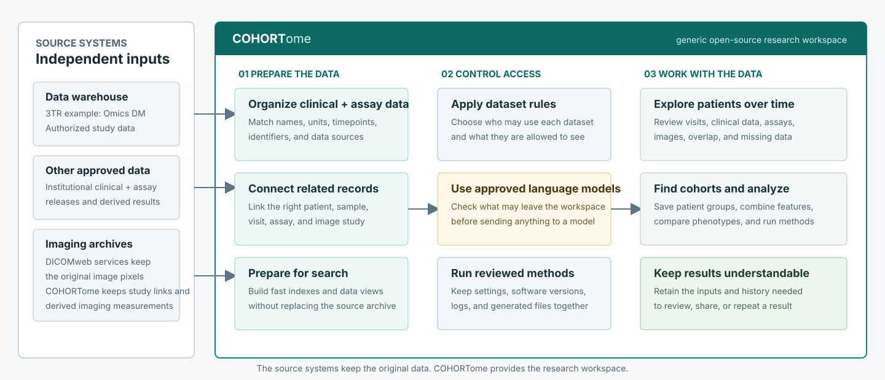

<p align="center">
  
</p>

<h1 align="center"><span style="color:#172a32;font-weight:700">COHORT</span><span style="color:#0e6964;font-weight:400">ome</span></h1>

<p align="center"><strong>Clinical histories and multimodal assays, connected.</strong></p>

<p align="center">
  <a href="https://mrueda.github.io/cohortome/">Documentation</a> |
  <a href="https://mrueda.github.io/cohortome/docs/overview">Overview</a> |
  <a href="https://mrueda.github.io/cohortome/api/">API</a> |
  <a href="LICENSE">Apache-2.0</a>
</p>

COHORTome is an open-source research workspace for longitudinal clinical data
and multimodal assays. It connects patients, samples, visits, and measurements
so researchers can explore available data, define cohorts, and carry a clear
data scope into traceable analyses.

<p align="center">
  
</p>

## At A Glance

- longitudinal clinical and multimodal assay exploration
- patient- and sample-aware cohort discovery
- multimodal overlap, missingness, and feature-matrix readiness
- curated analyses with persisted inputs, outputs, and run history
- optional policy-controlled language-model assistance
- optional DICOM viewing through OHIF and a separate DICOMweb archive

COHORTome does not replace a primary warehouse, PACS, specialist analysis
pipeline, or clinical decision-support system.

> **Status:** COHORTome is research software under active development. The
> checked-in data are synthetic and test software behavior, not disease biology.

## Development Start

Python 3.11 or newer is recommended.

```bash
git clone https://github.com/mrueda/cohortome.git
cd cohortome

python3 -m venv .venv
source .venv/bin/activate
python -m pip install -e '.[test,dicom]'

COHORTOME_AUTH_MODE=none uvicorn app.main:app --host 127.0.0.1 --port 8000 --reload
```

Open <http://127.0.0.1:8000>. On a fresh checkout, prepare the default
dataset store from **Data Admin** before applying it in **Datasets**.

For shared deployments, authentication, Docker, DICOM, and model-provider
configuration, use the documentation below rather than this quick development
path.

## Documentation

| Need | Start here |
| --- | --- |
| Understand the project | [Overview](https://mrueda.github.io/cohortome/docs/overview) |
| Read common questions, including the name | [FAQ](https://mrueda.github.io/cohortome/docs/about/faq) |
| Follow common research workflows | [User journeys](https://mrueda.github.io/cohortome/docs/user-guide/user-journeys) |
| Run from source with authentication | [Local auth and groups](https://mrueda.github.io/cohortome/docs/admin-guide/local-auth-and-groups) |
| Deploy with Docker | [Docker deployment](docker/README.md) |
| Enable OHIF/DICOMweb | [DICOM viewing](https://mrueda.github.io/cohortome/docs/admin-guide/dicom-viewing) |
| Configure language models | [Model providers](https://mrueda.github.io/cohortome/docs/admin-guide/model-providers) |
| Understand system boundaries | [Scope and boundaries](https://mrueda.github.io/cohortome/docs/project/scope-and-boundaries) |
| Work with the code or API | [Architecture](https://mrueda.github.io/cohortome/docs/developer-guide/architecture) and [API reference](https://mrueda.github.io/cohortome/api/) |

## 3TR Context

COHORTome is generic software whose first planned consortium-scale deployment
is in the context of [3TR](https://www.3tr-imi.eu/). PRECISESADS data held in
the 3TR Omics DM Warehouse provide the first real reference implementation,
with collaborators at Fundacion Publica Andaluza Progreso y Salud (FPS) in
Granada.

## Tests

```bash
make test
make test-ui
make test-all
```

## Citation And License

A software manuscript with a PRECISESADS translational use case is in
preparation. Until a formal citation is available, cite the repository and the
exact release or commit used.

Copyright 2026 Manuel Rueda - CNAG. Licensed under the
[Apache License 2.0](LICENSE); see [NOTICE](NOTICE).
