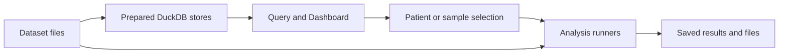

# Architecture

Desktop and Web use the same FastAPI backend and JavaScript interface.
Desktop wraps them in Tauri; Web serves the interface to authenticated browsers.

## Components

| Component | Role |
| --- | --- |
| Tauri / browser | Displays the interface |
| FastAPI | Resolves dataset access, handles queries, and runs or submits analyses |
| DuckDB | Queries prepared per-dataset stores |
| Dataset files | Clinical records, assay matrices, manifests, and sample links |
| Runtime storage | Chats, cohorts, settings, job records, and results |
| Analysis runners | Python, R, Pheno-Ranker, and configured workflows |
| Optional services | Language models and DICOMweb/OHIF imaging |

## Data flow

Each dataset has its own prepared store. A workspace attaches the selected
stores to one query session; it does not build a new database for every
combination. Records retain their source dataset, including when patient IDs
repeat across datasets.

Large assay matrices can remain outside DuckDB. Runners read the selected
matrix and its linkage metadata. DICOM pixels remain in the configured image
service; derived imaging measurements use the assay-matrix format.

## Execution

| | Desktop | Web |
| --- | --- | --- |
| Interface | Tauri window | Browser |
| Access | Local owner, no application login | Individual accounts and dataset permissions |
| Background jobs | Local subprocess queue | Redis and RQ workers |
| Storage | Local runtime | Server runtime, separated by user |

Short operations run directly. Methods configured as jobs use the corresponding
queue. The YAML analysis catalog declares method requirements and runner settings;
it does not execute arbitrary commands from a prompt.

The custom Python/R prototype uses a separate restricted container and accepts
only the bundled synthetic autoimmune dataset.

## Model calls

COHORTome checks dataset policies before sending context to an approved
OpenAI-compatible endpoint. A model can help plan a query or explain a result;
the backend executes the supported operation.

**General question** sends the user's prompt and its separate recent history,
without attaching workspace data. See
[Query disclosure](query-disclosure-modes.md) for the policy rules.

## Further details

- [State and persistence](state-and-persistence.md)
- [API reference](/api/)
- [Dataset configuration](../admin-guide/datasets-and-access.mdx)
- [Security configuration](../admin-guide/real-data-security.md)
