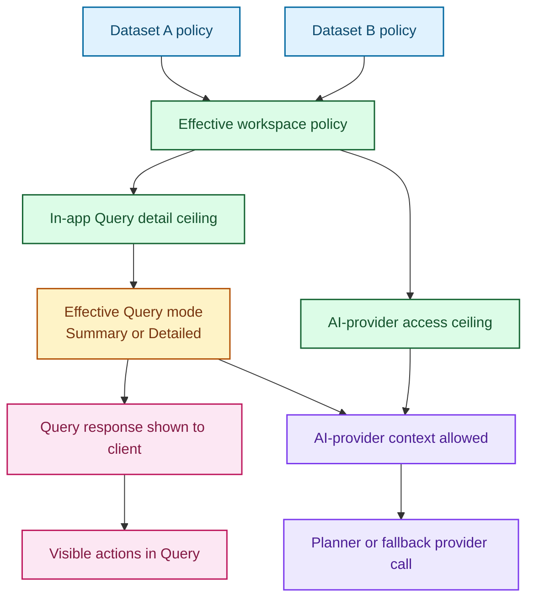

# Query Disclosure Modes

This note records the current Query disclosure design in COHORTome.

It is still intentionally narrower than a full privacy architecture, but it now reflects the implemented Query behavior rather than only an initial design sketch.

## Why This Exists

COHORTome may eventually send selected query or analysis context to external LLM providers for richer interpretation.

Today, most query behavior is effectively record-level when the result includes patient IDs, row-level payloads, or actions derived from visible IDs.

Before expanding LLM usage, the app needs a simple and explicit disclosure model.

## User-Facing Model

Query still operates with two effective in-app disclosure levels:

- `Summary`
- `Detailed`

But the current product no longer lets the user toggle them manually in Query.

Instead:

- dataset policy defines the ceiling
- the workspace applies the strictest selected dataset policy
- Query shows the resulting mode as read-only workspace state

### Summary

`Summary` allows only reduced answers to be exposed outside the app's rich internal result.

Typical responses may be:

- boolean answers
- counts
- grouped summaries
- aggregate trends

`Summary` must not expose patient IDs, record IDs, or raw row-level payloads:

- to AI providers
- to the frontend response payload

Current Query behavior in `Summary`:

- patient/record detail lookups are blocked
- `action_context` is redacted before the response reaches the client
- Query handoff actions are disabled:
  - `Open in Analysis`
  - `Save cohort`
  - `Copy patient IDs`
  - `Use in Pheno-Ranker`
- `Prompt scope` follow-up memory is hidden in the UI

### Detailed

`Detailed` allows patient-level or record-level detail when needed and permitted by the app.

Typical responses may include:

- patient IDs
- record/timepoint IDs
- row-level result tables
- detailed patient-oriented handoff context

`Detailed` does not imply unrestricted access. Existing dataset scope, authorization, and app-level policy still apply.

Current Query behavior in `Detailed`:

- patient-level and record-level answers can be returned to the authorized client in bounded pages
- Query handoff actions can be enabled when scope exists
- `Prompt scope` follow-up memory can reuse the complete previous Query result through a server-side handle

## Internal Model

Internally, the app may still distinguish finer result shapes:

- `boolean`
- `count`
- `aggregate`
- `record_level`

These are implementation concepts, not user-facing controls.

The mapping is:

- `Summary` -> `boolean`, `count`, or `aggregate`
- `Detailed` -> `record_level`

The backend should choose the lowest sufficient internal level for a `Summary` answer.

## Core Principle

The app should compute richly inside and expose minimally outside.

That means:

1. Parse the user intent.
2. Run the local deterministic or planner-backed computation.
3. Build a disclosure-filtered representation of the result.
4. Render only that filtered representation in the UI.
5. If an AI provider is used, send only that filtered representation.

The app now distinguishes:

- in-app Query disclosure
- AI-provider exposure

These are related, but not identical.

## Policy Flow

Read it as:

- datasets contribute policy ceilings
- the workspace applies the strictest selected dataset policy
- the client response and any AI-provider context are then filtered from that effective policy

## Query Response Metadata

Query responses now carry explicit disclosure metadata, separate from execution metadata such as `Deterministic` or `LLM-planned`.

The UI deliberately avoids presenting both policy layers as generic
"disclosure" badges:

- `Response detail` says what the authorized user can see in COHORTome.
- `Model context` says what was actually supplied to the selected model.

For example, `Response detail: Detailed` together with `Model context: Safe
summary` means the application may return detailed local results to the user,
while the model received only reduced structural context.

The explicit `General question` context is outside this workspace-disclosure
model. It calls `POST /llm/general` with only the prompt and recent
General-question history, so the UI reports `No workspace context` rather than
`Response detail` or `Model context`. The endpoint does not resolve the active
dataset and cannot return workspace actions.

Current fields:

- `granularity_requested`
- `granularity_applied`
- `external_llm_allowed`
- `available_actions`
- `ai_provider_access`
- `ai_provider_context_granularity`

Notes:

- `granularity_requested` is still recorded in the response model for compatibility, but current Query behavior derives it automatically from the effective workspace mode.
- `granularity_applied` is the effective disclosure level after routing and policy checks.
- `available_actions` is backend-provided capability metadata for the UI.
- `ai_provider_access` is the effective dataset/workspace AI-provider policy.
- `ai_provider_context_granularity` records what level of context an AI provider was allowed to receive when one was actually used.

## Actions And Handoffs

This feature is not only about the text reply.

It also affects:

- `Open in Analysis`
- `Save cohort`
- `Copy patient IDs`
- `Use IDs in Pheno-Ranker`

Visible text must not be the source of truth for these actions.

Instead:

- the backend owns the internal result
- the backend declares which actions are allowed

Current Query implementation is stricter than the original idea:

- a `Summary` result does not allow local handoff actions
- a `Detailed` list result exposes at most one bounded page at a time
- the complete ordered result is stored behind an opaque, user-scoped handle
- count intents return no member IDs, result handle, or cohort actions
- paging and handle-backed actions reauthorize the stored workspace and require
  its current policy to allow `Detailed`

The initial page size is 50 and the API hard maximum is 100. A handle expires
after one hour. It is invalidated when its workspace binding becomes stale and
cannot be used by another user. `Save cohort`, `Open in Analysis`, and Query
follow-up scope pass the handle rather than a client-supplied bulk ID array.

## V1 Scope

V1 should be intentionally narrow.

Included:

- Query-only implementation
- automatic workspace-level `Summary` / `Detailed` application from dataset policy
- response badge showing the applied response-detail mode
- output shaping for a small set of common query intents
- backend-declared action capabilities
- bounded Detailed result pages and transient, authorized result handles
- dataset-level policy ceilings for:
  - in-app Query detail
  - AI-provider access

Not included:

- MCP implementation
- full Pheno-Ranker rollout
- full privacy or compliance framework

## Why MCP Is Out Of Scope For V1

MCP is a future interface, not the foundation of this feature.

The disclosure policy should exist independently of transport or client type.

The intended layering is:

- COHORTome backend defines disclosure policy
- Query/Analysis/Pheno-Ranker consume that policy
- external LLM calls obey that policy
- MCP, if added later, also obeys that policy

## Implementation Direction

The first implementation should avoid four separate query engines.

Preferred approach:

- keep one internal query computation path
- add a disclosure-aware output shaping layer
- keep action availability separate from visible payload shape

This reduces complexity and keeps the Query backend as the source of truth.

## Dataset Policy Layer

Dataset administration now controls two separate Query-related ceilings:

- `In-app Query detail`
  - `Summary only`
  - `Detailed allowed`
- `AI providers`
  - `Detailed allowed`
  - `Safe summary`
  - `Blocked`

Data classification and the selected provider boundary are applied before these
ceilings. A private dataset forces `Blocked` for an external provider. With a
local provider, the configured dataset ceiling applies normally.

For multi-dataset workspaces, the strictest selected dataset policy wins.

This means:

- if any selected dataset is `Summary only`, the workspace Query thread cannot use `Detailed`
- if any selected dataset is `Safe summary`, AI providers are restricted to provider-safe structural context for the workspace
- if any selected dataset is `Blocked`, AI providers are blocked for the workspace
- if any selected dataset is private and the provider is external, AI providers
  are blocked for the workspace regardless of the configured context ceiling

## Safe Summary AI Provider Mode

`AI providers = Safe summary` does not mean aggregate clinical context.

In current Query behavior, safe-summary mode means:

- semantic planner is skipped
- only structural, non-clinical context may leave the backend
- no diseases
- no treatments
- no counts
- no top terms
- no patient-derived summaries

If a prompt needs private clinical context, the provider should answer that it does not have enough permitted context.

## Remaining Questions

- Should Pheno-Ranker accept transient Query handles directly, or require the
  user to promote them to saved cohorts first?
- Should Analysis adopt the same split between in-app disclosure and AI-provider exposure?
- Should a future `Local only` mode be exposed in the UI, or remain an internal execution policy?
