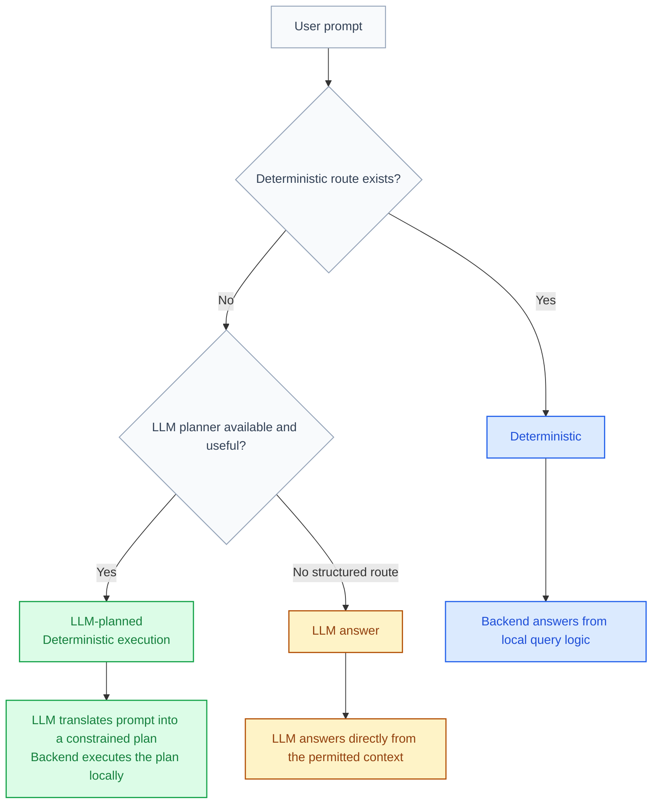

# Query

`Query` is the main subset-building interface.

:::tip Best use
Use `Query` first when your goal is to define a subset cleanly before interpreting it elsewhere.
:::

## What Query can do

- list patients or samples in the current workspace
- filter by disease or medication
- support deterministic and LLM-planned prompts
- save subsets as saved cohorts when the current Query thread allows detailed handoff
- open the current result in Analysis when the current Query thread allows detailed handoff

## Typical use cases

Common examples include:

- `Tell me the list of patients in the workspace`
- `How many patients take biologics?`
- `Which patients have Crohn Disease?`
- `Which patients do not have Crohn Disease but take Infliximab?`

## Choose the question context

The composer has an explicit context switch:

- `Workspace` asks about the active data and can use deterministic or
  model-planned execution under the workspace policy.
- `General question` asks the selected approved model without supplying an
  active dataset, patient list, assay inventory, or other workspace context.

General questions are useful for quick background explanations such as “What
is aspirin?” They also work when no dataset is selected. Their result is marked
`No workspace context`, and their conversation history is kept separate from
workspace questions.

COHORTome does not automatically turn an unsupported workspace question into a
general one. This keeps a question that may contain private study details from
being sent under a different context than the user selected.

:::caution General questions still leave the browser
The question text and recent General-question history are sent to the selected
model provider. Do not paste confidential or patient-level information into an
external provider.
:::

## Result types

Query can return:

- patient-level lists
- sample-level lists
- counts
- deterministic summaries

### Large lists

Large patient or sample lists are paged. Query shows the first 50 matches and
the total result size, then offers `Load more` when additional rows are
available. It does not place the complete list in the chat reply.

The complete ordered membership stays temporarily on the COHORTome server
behind an opaque result handle. The handle lasts for one hour and remains bound
to the user, workspace, and current access policy. COHORTome rechecks those
conditions when another page is requested or the result is handed to another
tool.

Count questions are intentionally smaller: `How many ...?` returns the count,
not a hidden patient list or a reusable result handle. Ask `Which patients ...?`
when you need a subset that can be inspected, refined, saved, or analyzed.

The wording matters:

- `patients`
  - patient-level result
- `samples`, `biosamples`, `specimens`, `records`
  - sample-level result

:::info Wording matters
If you ask for `patients`, the answer should be patient-oriented.

If you ask for `samples`, `records`, or `timepoints`, the answer should be sample-oriented.
:::

## Current terminology

The app now prefers `workspace` for the loaded data scope. That means prompts like these are valid:

- `Tell me the list of patients in the workspace`
- `How many timepoints are in this workspace?`

## Query disclosure mode

`Query` still has two effective in-app disclosure levels:

- `Summary`
- `Detailed`

But users no longer switch them manually in the Query tab.

The mode is now applied automatically from the active workspace policy:

- if every selected dataset allows detailed Query, the workspace runs in `Detailed`
- if any selected dataset is `Summary only`, the workspace runs in `Summary`

The Query header shows the effective mode as a read-only workspace indicator.

After a query, provenance uses two separate badges:

- `Response detail` describes what may be shown to you inside COHORTome.
- `Model context` appears when a model was consulted and describes what the
  model actually received.

These values can differ. `Response detail: Detailed` and `Model context: Safe
summary` means detailed local results are allowed in your session, but only a
reduced summary was sent to the model.

These badges apply to `Workspace` questions. A `General question` instead shows
`No workspace context`, because no dataset-derived context was supplied.

## Latest query details

The collapsed `Latest query details` panel shows how the latest answer was
produced and its structured response metadata. It is visible by default. Turn
`Latest query details` off in `Settings` when you prefer a simpler Query view;
this changes only the panel's visibility, not Query execution, model context,
or disclosure policy.

### Summary

Use `Summary` when the active workspace is governed for reduced in-app answers such as:

- counts
- grouped summaries
- aggregate-style answers

In `Summary`:

- patient and record detail lookups are blocked
- Query does not expose patient or record IDs to the client
- Query handoff actions are hidden or disabled

### Detailed

`Detailed` is available only when the workspace policy allows it. In that mode Query can return:

- patient-level answers
- record-level answers
- Query handoff actions such as `Open in Analysis` or `Save cohort`

## Prompt scope

`Query` has its own local prompt-scope control.

This is different from the global workspace shown in the top bar:

- global `Scope`
  - the actual loaded app scope
- `Query` prompt scope
  - the scope used for the next Query prompt

The button can show states such as:

- `Prompt scope: workspace`
- `Prompt scope: previous result (5 patients)`
- `Prompt scope: waiting for previous result`

:::info
The top `Scope` pill still refers to the real loaded workspace.

`Prompt scope` is a Query-local refinement layer, not a replacement for the app-wide scope.
:::

## Query memory

By default, Query runs on the current workspace.

If the user enables `Prompt scope: previous result`, follow-up Query prompts can reuse the last Query subset instead. For a paged result, the backend applies the complete result membership, not only the visible page.

Example:

1. `How many patients have Crohn Disease?`
2. enable `Prompt scope: previous result`
3. `How many are female?`

In that situation, the second question is interpreted inside the Crohn subset rather than the full workspace.

:::warning
Query memory is opt-in.

The app does not silently narrow follow-up prompts unless the user enables the prompt-scope control.
:::

:::note
`Prompt scope` is currently available only when the active workspace is in `Detailed`.

It is hidden in `Summary` because aggregate-only results do not create the
member-level result handle needed for follow-up scope reuse.
:::

## Full-workspace override

Even when Query memory is enabled, the user can explicitly ask for the broader scope again.

Examples:

- `How many female patients are in the full workspace?`
- `List all patients in the workspace`

That explicit wording tells Query to ignore the remembered subset and use the full current workspace.

## Deterministic versus LLM-planned

`Query` supports more than one execution style:

- `Deterministic`
  - direct app logic and known filters
- `LLM-planned`
  - the model interprets the language, but the app still tries to execute a structured result
- `LLM answer`
  - model-generated answer when there is not a structured deterministic path

In practice:

- exact disease or medication filters often behave deterministically
- more natural phrasing and mixed conditions often benefit from `Use LLM planner`
- LLM fallback still uses the current Query prompt scope when one is active

Suggested follow-up questions use the same disclosure before you click them:

- blue `Deterministic` follow-ups run only through deterministic Query logic
- green `LLM-planned` follow-ups ask the model to create a structured plan, which the app then executes

The text label is always shown alongside the color, and selecting a follow-up pins that execution path for the next query.

:::note
`Use LLM planner` here describes execution behavior, not a permanent user-facing mode switch. The current Query tab applies in-app disclosure automatically from workspace policy.
:::

## AI-provider policy

`Query` distinguishes:

- what the user is allowed to see inside COHORTome
- what COHORTome is allowed to send to AI providers

The dataset/workspace AI-provider policy is separate from the in-app Query mode:

- `Detailed allowed`
- `Safe summary`
- `Blocked`

Data classification is applied first: private dataset context can be used by an
approved local provider when policy allows it, but never by an external
provider.

Examples:

- a workspace may allow `Detailed` in-app Query answers while still allowing only `Safe summary` context to AI providers
- a deterministic Query turn may show a rich local answer without sending anything to a provider at all

:::info
Provider badges appear only when an AI provider was actually used for that Query turn.
:::

## Query Label Meanings

The Query badges distinguish three different execution paths:

Read the labels as:

- `Deterministic`
  - blue
  - the app answered using local query logic only
- `LLM-planned`
  - green
  - the model translated the language into a constrained internal plan, but the app still executed the result locally
- `LLM answer`
  - amber
  - the model answered directly from the permitted context because no deterministic or structured planned route was used

## Disease shortcuts

The disease selector in Query is a shortcut for deterministic or LLM-planned subset building. It is especially useful for:

- common diseases
- Healthy Controls
- quickly opening a subset in Analysis

## Handoff actions

Query results can be reused through the action buttons:

- `Open in Analysis`
- `Save cohort`
- `More actions`

These are available only when the current Query thread and current result allow them.

For a paged result, `Save cohort` and `Open in Analysis` use the server-held
result directly. Saving promotes the temporary result to a durable saved
cohort; the browser does not have to send hundreds of IDs back to the server.

:::note
In current Query behavior, `Summary` does not offer handoff actions.

Use a workspace with `Detailed` in-app Query access when the next step is to save, inspect, or hand off the matching subset.
:::

## Practical advice

Use `Query` when the main question is:

- who is in the current subset
- how many match a condition
- which disease or medication filters define the subset you want to analyze next

Use `Prompt scope: previous result` when:

- the user is refining the same subset step by step
- the next question should stay local to the previous Query result

This currently means using a `Detailed` Query thread.

Leave it at `Prompt scope: workspace` when:

- the user wants a fresh question against the loaded workspace
- the previous Query result is no longer the intended scope
